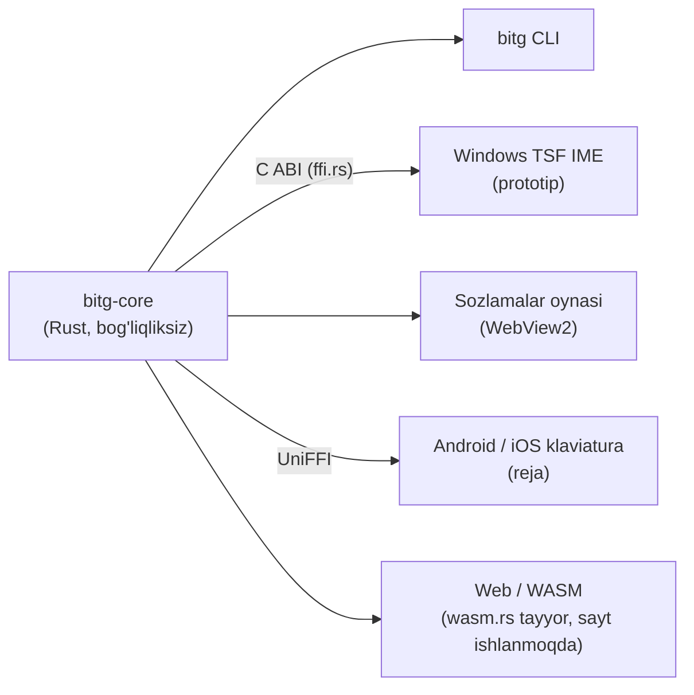

# bitg

**O'zbek matnini 2026-yilgi lotin alifbosiga o'giradi — yozish paytida, hamma joyda, inglizchani buzmasdan.**
*Uzbek text to the 2026 Latin alphabet (ö ğ ş ç ʼ) — as you type, everywhere, without breaking English.*

> Bitig — qadimgi turkiy tilda «yozuv». [bitg.uz](https://bitg.uz)

O'RQ-1184 qonuni (2026-10-21) to'rtta harfni almashtirdi: **Oʻ → Ö, Gʻ → Ğ, Sh → Ş, Ch → Ç**. Qonun 2027-yil
aprelida kuchga kiradi. bitg — shu o'tishni bir klaviatura bosishiga aylantiradigan ochiq kodli yadro va ilovalar.

```text
$ bitg "O'zbekiston shaharlari: Toshkent, Samarqand"
Özbekiston şaharlari: Toşkent, Samarqand

$ bitg "Please check the schedule, keyin choy ichamiz"
Please check the schedule, keyin çoy içamiz

$ bitg old --ascii "Özbekiston şaharlari"
O'zbekiston shaharlari
```

## Nimasi bilan boshqacha

| | |
|---|---|
| 🧠 **Inglizchani tushunadi** | So'z o'zbekcha ekaniga dalil bo'lmasa — tegmaydi. Lug'atlar (o'zbek korpusi + SCOWL), qo'shimchalar bo'yicha o'zak, harf belgilari va gap konteksti: `check`, `How are you shah`, `Obama's` o'zgarmaydi; `Menga chat yozing` → `Menga çat yozing`. |
| 🔒 **Kod va havolalarga tegmaydi** | URL, email, `@user`, `#teg`, domen, `snake_case`, `camelCase`, `push()`, `shahar123` (parolga o'xshash). |
| ✍️ **Tutuq va tirnoqni ajratadi** | 12 xil apostrof bitta deb qaraladi; `'Yaxshi tong'` — tirnoq, `tog'` — ğ; `Is'hoq` → `Ishoq`. |
| 🔁 **Uch yo'nalish** | eski lotin → yangi, kirill → yangi (eng aniq yo'l), yangi → eski (o'tish davri saytlari uchun). |
| ⚡ **Tez va yengil** | 1.4–2.7 µs/so'z, lug'at yuklash 0 ms (qurish vaqtida tayyor jadval), 1.1 MB xotira; tarmoq yo'q, tashqi bog'liqlik yo'q. Bitta yadro: Windows IME, CLI, mobil, web. |
| 📏 **O'lchanadi** | `bitg eval` — real korpusda aniqlik va tezlik. Har o'zgarish raqam bilan tekshiriladi. |

## Sifat (hozirgi holat)

| To'plam | Natija |
|---|---|
| O'zbekcha gaplar (3000 ta, kirill matndan: kirish = eski lotin, kutilgan = yangi lotin, apostrof turlari aralash) | **99.17%** (farqning ko'pi kirill korpus xatosi: maşğul, ğalaba) |
| Apostrofsiz yozilgan o'zbekcha ("ozbek", "togri"; boshqa 3000 gap): butun gap to'g'ri | **69.07%** gap (2072/3000). Lug'at kengaytirilsa oshadi — ish jarayonida |
| Inglizcha gaplar (sh/ch/apostrof bor, 3000 ta, Leipzig news + web) — o'zgarmasligi kerak | **99.73%** |
| Tezlik | 2.7 µs/so'z o'zbekcha, 1.4 µs/so'z inglizcha matnda (release, x64) |

O'lchov sanasi: 2026-11-12, `bitg eval eval/out/{uz,uz_noapos,en}.tsv`.

### Tezlik va resurs: raqobatchilar bilan bir xil matnda

Bir xil 3000 gapda (`eval/out/uz.tsv`, 42 670 so'z; `en.tsv`, 62 082 so'z). Raqobatchilar dvigateli ularning
saytidagi JS bundle'dan olinib, o'zgartirmasdan Node 'da yurgizildi; bitg — `cargo run --release -p bitg-core
--example bench -- eval/out/uz.tsv`. Isitishdan keyin 5 marta o'rtachasi, bitta mashina.

| | o'zbekcha matn | inglizcha matn | ishga tushish | xotira | inglizcha himoya |
|---|---|---|---|---|---|
| **bitg** (Rust, native) | 2.72 µs/so'z | **1.40** µs/so'z | **0 ms** | **1.1 MB** private | lug'at + kontekst |
| alifbochi.uz (JS) | 2.33 | 1.45 | brauzer sahifasi | Node jarayoni 26–41 MB | yo'q (`shop → şop`) |
| alifbo.akbarovlabs.uz (JS) | 3.39 | 1.93 | brauzer sahifasi | 〃 | yo'q |
| webnum.uz (JS) | 2.27 | 2.06 | brauzer sahifasi | 〃 | faqat imlo belgisi (c, w, ph) |

Xulosa: faqat jadval bilan almashtiradigan konvertorlar o'zbekcha matnda ~15% tezroq, chunki bitg har so'zni
lug'at va kontekst bilan tekshiradi. Inglizcha matnda bitg eng tez. Har qanday holatda bu bir so'zga mikrosekund —
yozayotgan odam sezmaydi (tugmalar orasida ~100 000 µs). Resursda farq katta: lug'at binarga tayyor hash-jadval
bo'lib kiradi (`crates/bitg-core/build.rs`), ishga tushganda tahlil qilinmaydi va xotira ajratilmaydi, IME
yuklangan barcha dasturlar uni bitta nusxada bo'lishadi. Avval har dasturda 15–25 ms (sovuq diskda 0.5 s) va
~8 MB ketardi.

O'zbekcha to'plamda kirish ham, kutilgan javob ham kirill matndan mustaqil olinadi, shuning uchun konvertor
`Is'hoq → Ishoq`, `O'zA → ÖzA`, `Sh.Sharipov → Ş.Şaripov` kabi holatlarni o'zi topishi kerak. Qolgan "xatolarning"
ko'pi korpusdagi shovqin: kirill matndagi imlo xatosi (Киргизистон, Фаргона) — bitg ularni to'g'rilab qo'yadi.

**Apostrof tiklash** (`ozbek → özbek`): nomzod lug'atda asl so'zdan ancha ko'p uchrasa. Asl so'z ham haqiqiy
bo'lsa (`qol/qo'l`, `oz/o'z`, `yoq/yo'q`, `otdi/o'tdi`) — taxmin qilinmaydi. Apostrofsiz shakl haqiqiy so'zmi —
faqat kirill korpus aytadi (lotin matnidagi "bolgan" — xato yozuv).

To'plamni o'zingiz qurish: [`tools/build_eval.py`](tools/build_eval.py), so'ng `bitg eval eval/out/uz.tsv`.

## Tuzilma



| Crate | Vazifa |
|---|---|
| [`bitg-core`](crates/bitg-core) | qoidalar (`latin`), kirill (`cyrillic`), teskari (`reverse`), tokenlar (`token`), til dalili (`lang`), brendlar (`data/names.txt`), yozish sessiyasi (`Session`), C ABI (`ffi`), brauzer ABI (`wasm`, faqat wasm32) |
| [`bitg-cli`](crates/bitg-cli) | `bitg convert / old / explain / eval` |
| [`bitg-settings`](crates/bitg-settings) | sozlamalar oynasi: kalitlar, ro'yxatlar, jonli namuna (Windows, WebView2) |
| [`bitg-tsf`](crates/bitg-tsf) | Windows matn kiritish xizmati (TSF TIP, Rust): tugmalarga tegmaydi — matn o'zgarishini kuzatadi (`ITfTextEditSink`) va so'zdan keyin probel yozilganda o'sha so'zni joyida almashtiradi. Matnni bermaydigan dasturlarda (Qt: Telegram) — zaxira yo'l: bosilgan harflardan so'z yig'iladi, `SendInput` bilan Backspace + yangi so'z. Hook va clipboard yo'q |

### O'rnatish (Windows 10/11, x64)

[Releases](https://github.com/dtwinuz/bitg/releases) dan `bitg-<versiya>-x64.msi` ni oching. O'rnatuvchi barcha
foydalanuvchilar uchun ishlaydi. Oxirida bitg ochiladi va klaviaturani O'zbek (lotin) tiliga o'zi qo'shadi. So'ng
**Win + Probel** bilan «bitg» ni tanlang. Yangilash ham shu fayl bilan qilinadi: ochiq dasturlarni (Chrome, Telegram)
yopish va kompyuterni qayta yuklash shart emas.

| Nima | Qayerda |
|---|---|
| Ilova (tray + sozlamalar), CLI, litsenziyalar | `C:\Program Files\bitg\` (CLI PATH'ga qo'shiladi) |
| IME DLL | `C:\Program Files\bitg\ime\<versiya>\bitg_tsf.dll` — versiyali papka: yangi versiya ochiq dasturlarga xalaqit bermaydi |
| Start menyusi | «bitg» |
| Windows bilan ishga tushish | `HKLM\…\Run` (`--autostart`); har foydalanuvchi ilovadan o'chiradi → `HKCU\Software\bitg\Autostart=0` |
| Foydalanuvchi sozlamalari | `%APPDATA%\bitg` — o'chirishda saqlanib qoladi |

**Korporativ tarqatish** (GPO, Intune, SCCM, PDQ):

```powershell
msiexec /i bitg-0.1.0-x64.msi /qn /l*v bitg-install.log            # jim o'rnatish
msiexec /i bitg-0.1.0-x64.msi /qn AUTOSTART=0 ADDKEYBOARD=0         # trayni va klaviaturani avtomatik qo'shmaslik
msiexec /x bitg-0.1.0-x64.msi /qn                                   # o'chirish
```

| Xossa | Standart | Ma'nosi |
|---|---|---|
| `AUTOSTART` | `1` | barcha foydalanuvchilarda tray Windows bilan ishga tushadi |
| `ADDKEYBOARD` | `1` | ilova birinchi ochilganda klaviaturani foydalanuvchining tillar ro'yxatiga qo'shadi (har kimda bir marta; o'chirsa qaytadan qo'shilmaydi) |

Tanlov `HKLM\SOFTWARE\bitg` da saqlanadi, yangilashda eslab qolinadi (buyruq qatoridagi qiymat ustun). Qaytish kodlari
standart: `0` muvaffaqiyat, `3010` qayta yuklash tavsiya etiladi, `1603` xato (sababi `/l*v` logida). DLL ochiq
dasturlarda yuklangan holda **o'chirish** ~1 daqiqa olishi mumkin (Windows Installer band fayllarni tekshiradi). Fayl
baribir o'chadi, qayta yuklash kerak emas.

**«Windows kompyuteringizni himoya qildi» oynasi chiqsa.** Beta MSI hozircha imzolanmagan, shuning uchun
SmartScreen notanish nashriyotchi haqida ogohlantiradi. **Batafsil → Baribir ishga tushirish** ni bosing. Faylni
tekshirish: Release sahifasidagi `.sha256` bilan solishtiring:

```powershell
Get-FileHash .\bitg-0.1.0-x64.msi -Algorithm SHA256   # Release'dagi .sha256 bilan bir xil bo'lishi kerak
```

O'rnatuvchini qurish (WiX 5, .NET SDK): `pwsh installer/build.ps1` → `dist/bitg-<versiya>-x64.msi` + `.sha256`.
`-CertThumbprint` yoki `BITG_SIGN_PFX` bilan binarlar va MSI imzolanadi (SHA-256, vaqt tamg'asi). `v*` tegi qo'yilsa,
[`release`](.github/workflows/release.yml) workflow MSI'ni GitHub Release'ga chiqaradi.

Ishlab chiqishda (MSI'siz):

```powershell
cargo build --release -p bitg-tsf
regsvr32 target\release\bitg_tsf.dll          # administrator; o'chirish: regsvr32 /u ...
```

Log: `%LOCALAPPDATA%\bitg\tsf.log` — faqat dastur nomi va natija (`converted`, `word unchanged`, xato kodi);
yozilgan matn hech qachon saqlanmaydi.

**bitg ilovasi** — `bitg-settings.exe` ([`crates/bitg-settings`](crates/bitg-settings), WebView2; Start menyusida «bitg»):
tray belgisi (bosish — oyna, o'ng tugma — yoqish/o'chirish, o'chiq holatda kulrang), Windows bilan ishga tushish,
bitta nusxa. Bo'limlar: Asosiy (zarrachalardan yasalgan jonli harf Oʻ→Ö, Sh→Ş; bugungi va 14 kunlik statistika,
klaviatura o'rnatilganini tekshirish), Sinash, Matnni o'girish (eski↔yangi, kirill), Qoidalar, Dasturlar (har dastur
uchun yoqish/o'chirish), Istisnolar, Haqida. Statistika IME log'idan: unda faqat vaqt, dastur nomi va natija bor.
O'zgarishlar darhol saqlanadi; IME ularni bir soniya ichida, dasturlarni qayta ochmasdan qabul qiladi.
Dizayn yo'nalishi: [`crates/bitg-settings/DESIGN.md`](crates/bitg-settings/DESIGN.md).

Fayllar (qo'lda tahrirlash ham mumkin): `%APPDATA%\bitg\settings.ini` (`enabled`, `english_guard`, `cyrillic`,
`restore_apostrophes`, `tutuq`, `undo_backspace`, `undo_remember`, `fallback`, `disabled_apps`, `auto_convert`,
`keymap`, `layout`) va `%APPDATA%\bitg\exceptions.txt` (har qatorda bitta so'z).

| Dastur turi | Holat |
|---|---|
| TSF'ni to'liq qo'llaydigan (WPF, UWP/WinUI, Word, Chrome'ning ko'p maydonlari) | ✅ ishlaydi (CI'da avtomatik e2e: WPF x64/x86, Win32 EDIT x64) |
| Qt / eski IMM32 dasturlari (Telegram Desktop) | ⚠️ zaxira yo'l: bosilgan harflardan so'z yig'iladi, probeldan keyin Backspace + qayta yozish. CI'da Qt (PySide6 QTextEdit) e2e: birinchi so'z, bekor qilish, apostrof, tez yozilgan gap ([`tools/e2e/qt-e2e.py`](tools/e2e/qt-e2e.py)); qo'lda: [`docs/sinov-sozlar.md`](docs/sinov-sozlar.md). Ma'lum muammolar pastda |
| Terminallar (Termius, Windows Terminal, PuTTY...) | ⛔ standart holatda o'chiq (buyruq va parol yoziladi); oynadan yoqish mumkin |

#### Telegram (zaxira yo'l): ma'lum muammolar

| Belgi | Sabab | Holat |
|---|---|---|
| `öozbek`, `şshapaloq`, `qqo'l` — so'z o'girilib, darhol buzilib qaytadi (logda `converted` va shu soniyada `undo`) | bitg o'zi yuborgan Backspace'ni foydalanuvchiniki deb bildi va «bekor qilish»ni ishga tushirdi: Qt `dwExtraInfo` belgisini (RETYPE_TAG) TSF'ga yetkazmaydi | 2026-11-12 tuzatildi: belgiga qo'shimcha sanagich (`State::take_retype`, 1.5 s oyna). Telegram logida o'z-o'zidan `undo` endi yo'q |
| Tez yozganda so'z aralashadi (`shşahar`, `qo'l shaşap`) | probeldan keyingi Backspace + yangi so'z navbat oxiriga tushadi, foydalanuvchi oldindan yozgan harflar esa ulardan oldin turadi — Backspace'lar yangi harflarni o'chiradi | 2026-11-12 tuzatildi: tahrir navbatda turganda bosilgan tugmalar ushlanib, undan keyin qayta yuboriladi (tartib bo'yicha taniladi, `dwExtraInfo` kerak emas). Logda `fallback: keys typed ahead of retype, reordered`. CI'dagi Qt e2e tasdiqlagan; **Telegramda qo'lda tasdiqlanmagan** |
| Birinchi so'z o'girilmaydi / `word not tracked` | sabab endi logda: `fallback: word not tracked: <sabab>` | log kutilmoqda |
| Qotish | har tugma ishlovchisi ≥25 ms bo'lsa `slow test key / key down: N ms` | log kutilmoqda |

Telegramning o'zini avtomatik sinab bo'lmaydi: haqiqiy klaviatura bosishi (SendInput) kerak, ishlab chiquvchi mashinasida
global tugma yuborish taqiqlangan va u faqat CI VM'da (`GITHUB_ACTIONS=true`) ishlaydi. O'rniga CI'da Qt sinov ilovasi
Telegram bilan bir xil yo'ldan (IMM32/CUAS, matn TSF'ga berilmaydi) o'tadi.

`cargo run -p bitg-tsf --example activate` — profilni shu jarayonda yoqib, TSF nimani faol deb bilishini chiqaradi.

## Ishlatish

```sh
cargo install --path crates/bitg-cli
bitg explain "Chat with the team, keyin choy"   # har bir so'z bo'yicha qaror
```

### Fayllar va oldindan ko'rish

```sh
bitg file hujjat.docx              # → hujjat.yangi.docx (asl fayl o'zgarmaydi)
bitg file jadval.xlsx -o yangi.xlsx
bitg file eski.txt maqola.md       # matn fayllar (UTF-8)
bitg file hujjat.docx --old        # teskari: → hujjat.eski.docx
bitg file hujjat.docx --dry-run    # yozmasdan: "  12× o'zbek → özbek" va jami
bitg diff < maqola.txt             # matn bo'yicha: "3: shahar → şahar" (qator raqami bilan)
```

`.docx` da asosiy matn, kolontitullar, sahifa osti izohlari (footnote/endnote) va sharhlar o'giriladi; so'z bir nechta run'ga
bo'linib ketgan bo'lsa ham abzats bitta matn sifatida o'giriladi va formatlash (qalin, kursiv, shrift) joyida
qoladi. `.xlsx` da satrlar (shared strings, rich text, inline) o'giriladi — formula va sonlarga tegilmaydi.
Boshqa XML va zip yozuvlari baytma-bayt ko'chiriladi. Kirish fayli ustiga faqat `--in-place` bilan yoziladi.

Rust'dan:

```rust
use bitg_core::{convert, Options, Session};

let text = convert("O'zbekiston shaharlari", &Options::default());

// Yozish paytida (IME): so'z tugaganda
let mut s = Session::new();
if let Some(edit) = s.complete_word("choy", &Options::default()) {
    // edit.delete ta belgini o'chirib, edit.insert ni yozing
}
```

### Klaviatura tartibi (avto o'girishsiz)

Sozlamalar → **Klaviatura**: «Avtomatik o'girish» va «Yangi harflar tugmada» alohida yoqiladi. Ikkinchisi
yoqilsa, bitg klaviaturasi tanlangan oynada tugma darhol yangi harfni yozadi:

| Tartib | Nima o'zgaradi |
|---|---|
| Tilmoch (standart, [tilmoch.ai](https://tilmoch.ai/ru/terilmalar) asosida) | `[` ö, `]` ğ, `;` ş, `'` ç, `` ` `` tutuq ʼ (U+02BC); `\` → `;` `:`; qavslar va `;` `'` — AltGr bilan; `№` — AltGr+Shift+3 |
| [kiritish.uz](https://kiritish.uz/windows/) («Özbekça - yangi», MIT) | Tilmoch bilan deyarli bir xil: `[` ö, `]` ğ, `;` ş, `'` ç, `` ` `` ʼ, `\` → `;` `:`; AltGr+K/L — “ ” ‘ ’, AltGr+`-` — tire |
| [TezYechim](https://tezyechim.uz/en) («Özbek lotin 2026») | `[` ç, `]` ö, `-` ğ, `=` ş; tutuq — o'ng Alt + `'`; `[ ] - =` o'ng Alt bilan |
| Turkcha Q | `[` ğ, `]` ü, `;` ş, `'` i, `,` ö, `.` ç, `i` → ı; vergul `\`, nuqta `/` da |
| Faqat AltGr | hech narsa ko'chmaydi: o'ng Alt + O G S C → ö ğ ş ç |
| Kirill | Windows «O'zbek (kirill)» tartibi (`o` ў, `s` қ, `-` ғ, `=` ҳ); avto o'girish yoqiq bo'lsa kirillcha so'z probeldan keyin yangi lotinga o'tadi, o'chiq bo'lsa kirill qoladi |
| Maxsus | oynada tugmani bosib, 4 qatlamning (oddiy, Shift, AltGr, AltGr+Shift) istalganiga istalgan belgi |

Maxsus tartib `%APPDATA%\bitg\keymap.txt` da (har qator: `tugma oddiy Shift AltGr AltGr+Shift`, `-` — o'zgarmaydi,
`U+XXXX` — belgi kodi) va qo'lda tahrirlansa ham bir soniyada qabul qilinadi. Tartibni IME'ning o'zi bajaradi
(tray ilovasi shart emas, administrator oynalarida ham ishlaydi): tugma TSF'da ushlanadi va belgi tahrir
sessiyasida yoziladi (eski IMM32 dasturlarida qisqa kompozitsiya bilan), AltGr qatlamlari — o'ng Alt uchun
"preserved key". Ctrl/Alt/Win bilan tezkor tugmalar inglizcha joyida, o'chirilgan dasturlarda (terminallar)
tugmalar o'zgarmaydi.

**Backspace bilan bekor qilish:** so'z o'girilgandan keyin darhol Backspace bosilsa, asl so'z qaytadi va shu
dasturda boshqa o'girilmaydi. `exceptions.txt` ga doimiy yozish alohida sozlama — «Qaytarilgan so'zni istisnoga
yozish» (`undo_remember`, standart holatda **o'chiq**). Istisnolar sahifasida qidirish va o'chirish bor.

**Brendlar:** `crates/bitg-core/src/data/names.txt` — sh/ch li savdo belgilari (Photoshop, Chevrolet, Toshiba)
o'zbek qo'shimchasi bilan ham o'girilmaydi. Kishi va joy nomlari ro'yxatda yo'q: ular o'zbek imlosida yoziladi.

## Lug'at

`crates/bitg-core/src/data/*.tsv` — faqat so'z va og'irlik (matnlar emas):

* o'zbekcha: [Leipzig Corpora Collection](https://wortschatz.uni-leipzig.de/en/download/Uzbek) (CC BY 4.0)
* inglizcha: [SCOWL](http://wordlist.aspell.net/) (Kevin Atkinson, ruxsat beruvchi litsenziya)

Qayta qurish: `python -I tools/build_lexicon.py --scowl <dir> --leipzig <wiki-words.txt> --leipzig-cyrillic-only <community-words.txt>`

Kengaytirish (ish jarayonida): ko'proq ochiq litsenziyali o'zbek manbalari (Leipzig'ning katta to'plamlari,
Common Voice CC0, Tatoeba CC BY) — maqsad apostrofsiz matnda 69% dan yuqori, qolgan ikki o'lchov tushmasin.

## Yo'l xaritasi

- [x] Phase 0a — yadro, CLI, inglizcha himoya, o'lchov
- [x] O'zbekcha o'lchov (kirill korpusdan), Is'hoq/Ishoq lug'ati
- [ ] Phase 0b — Windows TSF IME prototipi (kod tayyor): qaysi dasturlarda ishlashini o'lchash (Chrome, Telegram, VS Code, Word)
- [ ] MVP — imzolangan Windows beta: TSF IME + tray, Backspace bilan qaytarish, istisnolar
- [ ] v1 — qonun kuchga kirishidan oldin (2027-aprel)
- [ ] **Linux (Ubuntu)** — IBus va Fcitx5 dvigateli (`bitg-core` C ABI orqali), `.deb` paket
- [ ] **iOS** — klaviatura kengaytmasi (Keyboard Extension), yadro `staticlib` sifatida
- [ ] macOS, Android; Word/brauzer kengaytmasi; B2B API
- [x] Sayt: [bitg.dtwin.uz](https://bitg.dtwin.uz) (`web/`), sinov maydoni haqiqiy yadroda (Rust → WASM)

## Telefonda (Android, iOS)

bitg'ning telefon versiyasi hali yo'q. Hozircha telefonda yangi alifbo bilan ishlash uchun **Tilmoch** ilovasi
yaxshi tanlov: tarjimon (16 til, ovozli rejim), turkiy tillar uchun moslangan —
[App Store](https://apps.apple.com/uz/app/tilmoch/id6739621237) ·
[Google Play](https://play.google.com/store/apps/details?id=com.tahrirchi.tilmoch) ·
[tilmoch.ai](https://tilmoch.ai/ru/product/mobile). Tilmoch'ning yangi alifbo klaviatura tartibi (Windows, macOS)
bitg'da `tilmoch` tartibi sifatida bor; ularning Android/iOS klaviaturasi «tez orada» deb e'lon qilingan.

## Litsenziya

MIT yoki Apache-2.0 — tanlovingiz bo'yicha.
