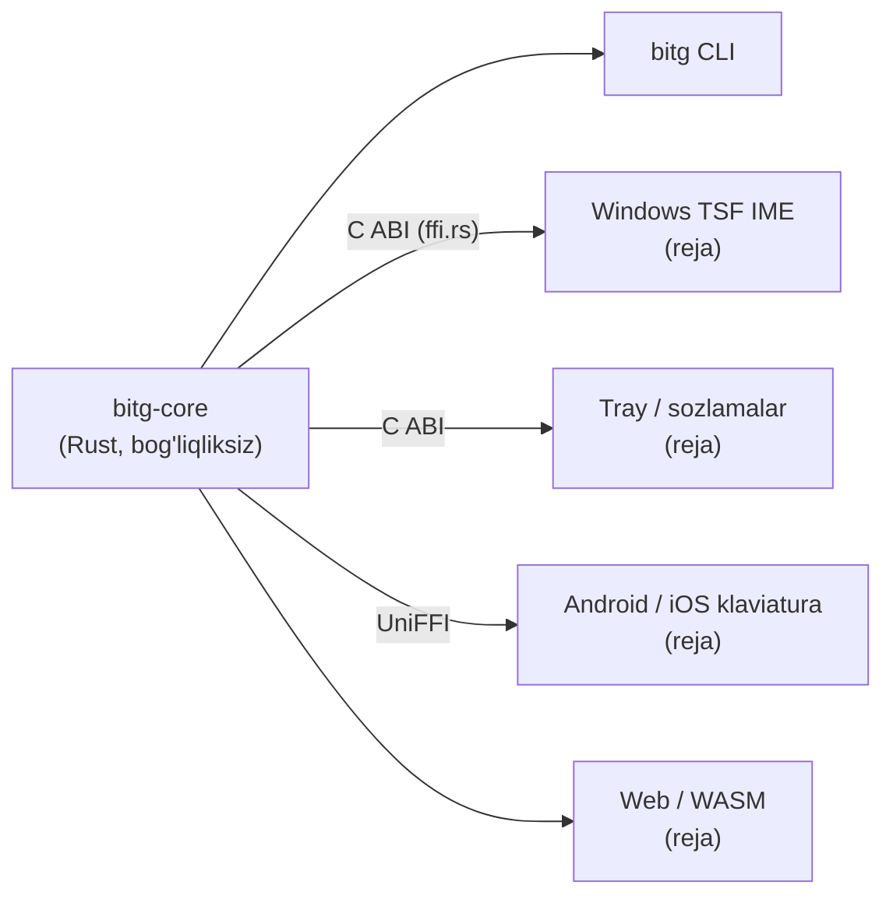

# bitg

**O'zbek matnini 2026-yilgi lotin alifbosiga o'giradi — yozish paytida, hamma joyda, inglizchani buzmasdan.**
*Uzbek text to the 2026 Latin alphabet (ö ğ ş ç ʼ) — as you type, everywhere, without breaking English.*

> Bitig — qadimgi turkiy tilda «yozuv». [bitg.uz](https://bitg.uz)

O'RQ-1184 qonuni (2026-10-21) to'rtta harfni almashtirdi: **Oʻ → Ö, Gʻ → Ğ, Sh → Ş, Ch → Ç**. Qonun 2027-yil
aprelida kuchga kiradi. bitg — shu o'tishni bir klaviatura bosishiga aylantiradigan ochiq kodli yadro va ilovalar.

```text
$ bitg "O'zbekiston shaharlari: Toshkent, Samarqand"
Özbekiston şaharlari: Toşkent, Samarqand

$ bitg "Please check the schedule, keyin choy ichamiz"
Please check the schedule, keyin çoy içamiz

$ bitg old --ascii "Özbekiston şaharlari"
O'zbekiston shaharlari
```

## Nimasi bilan boshqacha

| | |
|---|---|
| 🧠 **Inglizchani tushunadi** | So'z o'zbekcha ekaniga dalil bo'lmasa — tegmaydi. Lug'atlar (o'zbek korpusi + SCOWL), qo'shimchalar bo'yicha o'zak, harf belgilari va gap konteksti: `check`, `How are you shah`, `Obama's` o'zgarmaydi; `Menga chat yozing` → `Menga çat yozing`. |
| 🔒 **Kod va havolalarga tegmaydi** | URL, email, `@user`, `#teg`, domen, `snake_case`, `camelCase`, `push()`, `shahar123` (parolga o'xshash). |
| ✍️ **Tutuq va tirnoqni ajratadi** | 12 xil apostrof bitta deb qaraladi; `'Yaxshi tong'` — tirnoq, `tog'` — ğ; `Is'hoq` → `Ishoq`. |
| 🔁 **Uch yo'nalish** | eski lotin → yangi, kirill → yangi (eng aniq yo'l), yangi → eski (o'tish davri saytlari uchun). |
| ⚡ **Tez va yengil** | ~1.3 µs/so'z, tarmoq yo'q, holat yo'q, tashqi bog'liqlik yo'q. Bitta yadro: Windows IME, CLI, mobil, web. |
| 📏 **O'lchanadi** | `bitg eval` — real korpusda aniqlik va tezlik. Har o'zgarish raqam bilan tekshiriladi. |

## Sifat (hozirgi holat)

| To'plam | Natija |
|---|---|
| Inglizcha gaplar (sh/ch/apostrof bor, 3000 ta, Leipzig news + web) — o'zgarmasligi kerak | **99.87%** |
| Tezlik | ~1.3 µs/so'z (release, x64) |

To'plamni o'zingiz qurish: [`tools/build_eval.py`](tools/build_eval.py), so'ng `bitg eval eval/out/en.tsv`.

## Tuzilma



| Crate | Vazifa |
|---|---|
| [`bitg-core`](crates/bitg-core) | qoidalar (`latin`), kirill (`cyrillic`), teskari (`reverse`), tokenlar (`token`), til dalili (`lang`), yozish sessiyasi (`Session`), C ABI (`ffi`) |
| [`bitg-cli`](crates/bitg-cli) | `bitg convert / old / explain / eval` |

## Ishlatish

```sh
cargo install --path crates/bitg-cli
bitg explain "Chat with the team, keyin choy"   # har bir so'z bo'yicha qaror
```

Rust'dan:

```rust
use bitg_core::{convert, Options, Session};

let text = convert("O'zbekiston shaharlari", &Options::default());

// Yozish paytida (IME): so'z tugaganda
let mut s = Session::new();
if let Some(edit) = s.complete_word("choy", &Options::default()) {
    // edit.delete ta belgini o'chirib, edit.insert ni yozing
}
```

## Lug'at

`crates/bitg-core/src/data/*.tsv` — faqat so'z va og'irlik (matnlar emas):

* o'zbekcha: [Leipzig Corpora Collection](https://wortschatz.uni-leipzig.de/en/download/Uzbek) (CC BY 4.0)
* inglizcha: [SCOWL](http://wordlist.aspell.net/) (Kevin Atkinson, ruxsat beruvchi litsenziya)

Qayta qurish: `python -I tools/build_lexicon.py --scowl <dir> --leipzig <words.txt>...`

## Yo'l xaritasi

- [x] Phase 0a — yadro, CLI, inglizcha himoya, o'lchov
- [ ] Phase 0b — Windows TSF IME prototipi: qaysi dasturlarda kursor oldidagi matn o'qiladi (Chrome, Telegram, VS Code, Word)
- [ ] MVP — imzolangan Windows beta: TSF IME + tray, Backspace bilan qaytarish, istisnolar
- [ ] v1 — qonun kuchga kirishidan oldin (2027-aprel)
- [ ] Android, iOS, macOS, Linux; Word/brauzer kengaytmasi; B2B API

## Litsenziya

MIT yoki Apache-2.0 — tanlovingiz bo'yicha.
